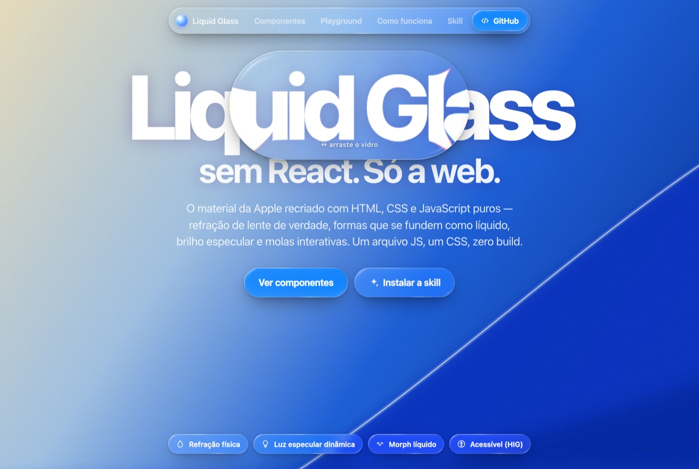
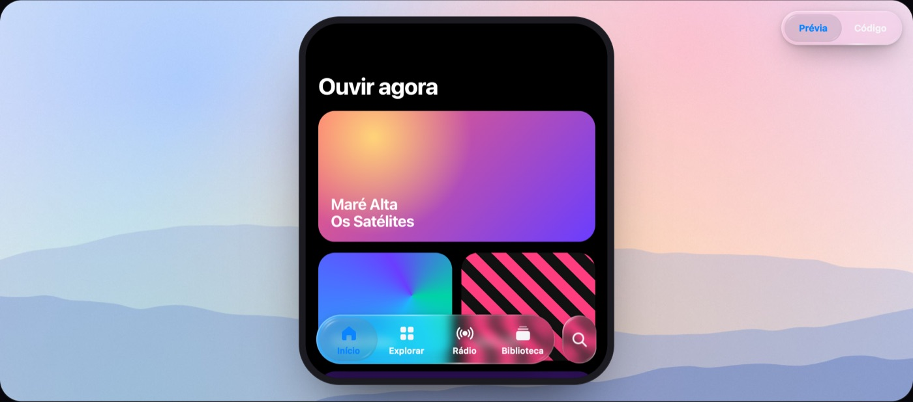
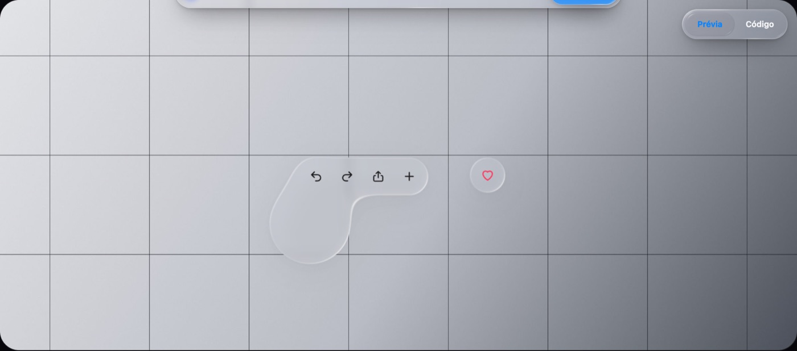
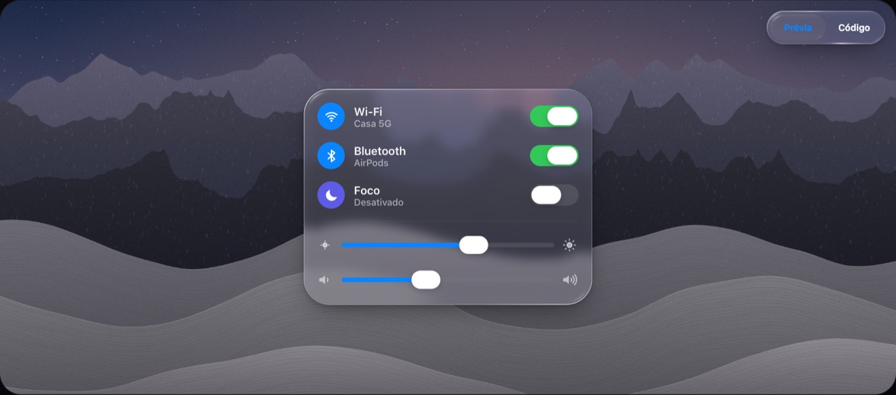
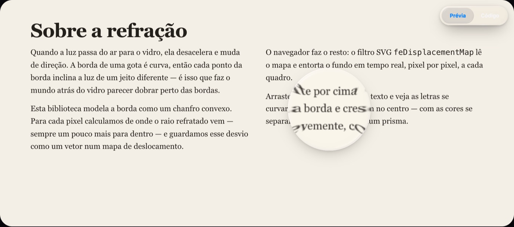

<div align="center">



# Liquid Glass para a web

**O material Liquid Glass da Apple recriado em HTML, CSS e JavaScript puros — e uma skill para o Claude construir com ele.**

Refração de lente de verdade · morph líquido entre formas · luz especular que segue o ponteiro · molas interruptíveis · componentes guiados pelo HIG

[**Ver a galeria ao vivo →**](https://asimov-academy.github.io/liquid-glass-skill/) &nbsp;·&nbsp; [Skill](#-skill-para-claude-code) &nbsp;·&nbsp; [Uso](#-uso-rápido) &nbsp;·&nbsp; [English](#english)

</div>

---

## ✨ O que tem aqui

| | |
|---|---|
| **`dist/`** | A biblioteca: `liquid-glass.js` + `liquid-glass.css` (~16 KB min+gzip, zero dependências, zero build) |
| **`skills/liquid-glass/`** | A skill para Claude Code / agentes: regras do HIG, API, receitas, armadilhas de cada navegador |
| **`index.html`** | Galeria interativa com 8 componentes, playground e explicação da ótica |
| **`examples/`** | Páginas pequenas e autocontidas para copiar: básico, navbar, tab bar, controles, menu, mídia em movimento |

<table>
<tr>
<td width="50%"><br><sub><b>Tab bar</b> — a seleção vira uma lente que amplia, estica com a velocidade e encaixa com mola.</sub></td>
<td width="50%"><br><sub><b>Morph líquido</b> — formas próximas viram uma superfície só (o <code>GlassEffectContainer</code> da Apple).</sub></td>
</tr>
<tr>
<td><br><sub><b>Switch e slider</b> — o knob vira gota de vidro durante o toque, sobre <code>&lt;input&gt;</code> nativo.</sub></td>
<td><br><sub><b>Lupa</b> — arraste e jogue: desliza com inércia e quica nas bordas.</sub></td>
</tr>
</table>

## 🚀 Uso rápido

```html
<link rel="stylesheet" href="https://cdn.jsdelivr.net/gh/asimov-academy/liquid-glass-skill@main/dist/liquid-glass.css">
<script src="https://cdn.jsdelivr.net/gh/asimov-academy/liquid-glass-skill@main/dist/liquid-glass.js" defer></script>

<!-- qualquer elemento com .glass vira vidro; o border-radius é o formato da lente -->
<nav class="glass" style="border-radius:999px; padding:6px 12px">…</nav>
<button class="glass lg-button" data-glass-interactive data-glass-tint="#0a84ff">Começar</button>
```

Para refração real também no **Safari e no Firefox**, envolva o fundo numa cena:

```html
<section class="lg-scene" style="position:relative">
  <div class="lg-backdrop" style="position:absolute; inset:0; background:url(foto.jpg) center/cover"></div>
  <button class="glass lg-button" data-glass-interactive>Tocar</button> <!-- fora do .lg-backdrop -->
</section>
```

### Componentes

```html
<button class="glass lg-button" data-glass-interactive>Botão</button>
<div class="glass lg-toolbar" role="toolbar">…</div>
<nav class="glass lg-tabs"><div class="lg-tabs-list" role="tablist"><button role="tab" aria-selected="true">Início</button>…</div></nav>
<div class="lg-menu"><button class="glass lg-button lg-icon" aria-haspopup="menu">•••</button><div class="glass lg-menu-panel" role="menu">…</div></div>
<label class="lg-switch"><input type="checkbox"></label>
<div class="lg-slider"><input type="range"></div>
<div class="lg-progressive-blur" data-direction="top"></div>
<div data-glass-group data-glass-merge="24">…vidros que se fundem…</div>
```

### Opções (atributos `data-`)

| Atributo | Padrão | Efeito |
|---|---|---|
| `data-glass="clear"` | regular | Variante transparente, para mídia rica |
| `data-glass-bezel` / `-refraction` | automático | Largura do bisel e quanto a borda dobra o fundo (px) |
| `data-glass-magnify` | 1 | Zoom de lente no centro |
| `data-glass-dispersion` | 0 | Aberração cromática (prisma) |
| `data-glass-blur` | 7 / 0.5 | Fosco (regular / clear) |
| `data-glass-tint` | — | Vidro colorido (ação principal) |
| `data-glass-dim` | — | Camada escura de 35% (HIG, clear sobre mídia clara) |
| `data-glass-interactive` | — | Cresce, estica e brilha no toque, com molas |
| `data-glass-draggable` | — | Arrastável com inércia |
| `data-glass-appearance` | light | `dark` / `light` / `auto` (no elemento ou em um ancestral) |

API JS completa, eventos e variáveis CSS: [`skills/liquid-glass/references/api.md`](skills/liquid-glass/references/api.md).

## 🧠 Skill para Claude Code

A skill ensina o Claude a usar o material **do jeito certo**: só na camada funcional (navegação e controles), regular vs. clear, dim de 35%, nada de vidro sobre vidro, acessibilidade, e as armadilhas que quebram o efeito em cada navegador.

**Como plugin (recomendado):**

```text
/plugin marketplace add asimov-academy/liquid-glass-skill
/plugin install liquid-glass@asimov-academy
```

**Manual:**

```bash
git clone https://github.com/asimov-academy/liquid-glass-skill
cp -r liquid-glass-skill/skills/liquid-glass ~/.claude/skills/
```

Depois é só pedir: *“cria uma landing com navbar de Liquid Glass sobre um vídeo”*, *“transforma esse player num card de vidro estilo iOS 26”*, *“faz uma tab bar com a lente líquida arrastável”*.

## 🔬 Como funciona

1. **Ótica** — a borda é um bisel convexo em forma de *squircle*. Para cada pixel o JS calcula a distância até a borda e a normal, e guarda num PNG quanto e para onde o fundo deve ser deslocado (R/G = vetor). O perfil é "sem dobras": a borda estica o conteúdo ao longo da curva sem duplicar letras.
2. **Renderização** — `feDisplacementMap` do SVG aplica o mapa:
   - **Chromium**: `backdrop-filter: url(#filtro)` refrata ao vivo qualquer coisa atrás do elemento.
   - **Safari / Firefox**: um filtro por `.lg-scene`, aplicado ao `.lg-backdrop`, com uma lente por elemento (em coordenadas fracionárias, que o WebKit respeita).
   - **Fallback**: vidro fosco com o mesmo aro, tint e molas.
3. **Luz e movimento** — sombreamento do bisel gerado das normais 3D, aro especular cônico que segue o ponteiro, brilho no ponto de toque e molas físicas interruptíveis.
4. **Morph** — grupos combinam as formas com *smooth-min* de campos de distância: elas criam um pescoço ao se aproximar e se separam como líquido.

Detalhes: [`references/how-it-works.md`](skills/liquid-glass/references/how-it-works.md).

## ♿ Acessibilidade

Respeita **Reduzir transparência** e **Aumentar contraste** (material opaco) e **Reduzir movimento** (sem molas nem luz dinâmica). Componentes usam `<button>` e `<input>` nativos, com teclado e leitores de tela.

## 🌐 Navegadores

| Navegador | Refração |
|---|---|
| Chrome, Edge, Arc, Opera, Samsung | Ao vivo, de tudo atrás do vidro |
| Safari (macOS/iOS) e Firefox | Do fundo da `.lg-scene`; fora de cena, vidro fosco |

## 🛠 Desenvolvimento

```bash
python3 -m http.server 5178          # sirva a raiz e abra http://127.0.0.1:5178
tools/build.sh                       # minifica dist/ e sincroniza a skill
cd tools && npm i && node render.mjs # regenera os wallpapers procedurais
```

Os fundos dos exemplos são gerados por código (`tools/wallpapers.html`) — nenhuma foto de banco de imagens.

---

<a name="english"></a>

## English

**Apple's Liquid Glass, rebuilt with plain HTML, CSS and JavaScript — plus an agent skill that teaches Claude to use it well.**

- Drop `dist/liquid-glass.css` + `dist/liquid-glass.js` into any page (or use the jsDelivr links above) and add `class="glass"` to floating UI. The `border-radius` is the lens shape.
- Real lens refraction via SVG displacement maps computed per element; live in Chromium through `backdrop-filter: url()`, and in Safari/Firefox inside a `.lg-scene` with a `.lg-backdrop`.
- Components: buttons, toolbars, tab bars/segmented controls with a draggable liquid lens, morphing menus, switches, sliders, progressive blur, magnifier lenses and liquid **morph groups** (GlassEffectContainer).
- Install the skill: `/plugin marketplace add asimov-academy/liquid-glass-skill` then `/plugin install liquid-glass@asimov-academy`, or copy `skills/liquid-glass` into `~/.claude/skills/`.
- Docs for agents and humans live in [`skills/liquid-glass/`](skills/liquid-glass/SKILL.md).

---

<div align="center">
<sub>Feito pela <a href="https://asimov.academy">Asimov Academy</a> · Licença <a href="LICENSE">MIT</a><br>
Inspirado no <a href="https://developer.apple.com/design/human-interface-guidelines/materials">Human Interface Guidelines</a>. Não afiliado à Apple Inc. “Liquid Glass” é uma marca da Apple.</sub>
</div>
